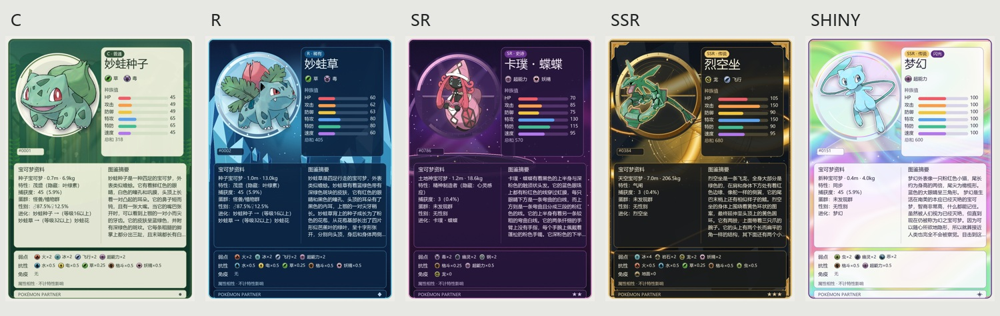

<p align="center">
  
</p>

<h1 align="center">宝可梦图鉴</h1>

<p align="center">每天抽取宝可梦，收集图鉴，用自己的宝可梦和群友对战。</p>

## 卡片预览

普通、稀有、史诗、传说与闪光，各有不同的背景和卡面。



[查看五张卡片大图](docs/CARDS.md)

在配置中可选择现有卡面或 TCG 风格卡面，详见[卡面设置](docs/CONFIGURATION.md)。

## 安装

在 AstrBot 的插件管理中选择「从仓库安装」，填入：

```text
https://github.com/Whereis-Alice/astrbot_plugin_pokemon_partner
```

安装完成后启用插件，即可在聊天中使用。缺少宝可梦图片时会自动下载并缓存；需要离线使用，或遇到中文显示问题，请查看[安装与图片设置](docs/ADMIN.md)。

## 开始玩

默认每天可抽 3 次，每次获得 1 只。重复宝可梦会变成星尘，用来兑换想要的宝可梦。

群聊里直接发送完整的 `今日宝可梦` 即可，无需前缀或 @ 机器人；其他指令按机器人的指令设置使用。

| 发送这句话 | 可以做什么 |
| --- | --- |
| `今日宝可梦` | 抽取宝可梦，收到文字提示和纯卡牌 |
| `我的宝可梦` | 按全国图鉴编号查看收藏 |
| `收集资料` | 查看收集进度、星尘和剩余次数 |
| `兑换宝可梦 皮卡丘` | 用星尘兑换指定宝可梦 |
| `宝可梦 皮卡丘` | 查看图鉴资料 |
| `图鉴帮助` | 查看更多指令 |

收藏、星尘和抽取次数按群保存，不同群互不影响；私聊的收藏独立保存。

## 和群友对战

发起挑战时，选择自己拥有的宝可梦，并 @ 要挑战的群友：

```text
宝可梦挑战 皮卡丘 @群友 20
```

对方选择自己拥有的宝可梦，即可开始：

```text
接收挑战 卡咪龟
```

宝可梦可以用名字，也可以用全国图鉴编号，例如皮卡丘是 `25`。只能选择自己已拥有的宝可梦。示例中的 `20` 是回合上限，可以省略。对局不消耗宝可梦或星尘，发送 `对战记录`、`对战排行` 可以查看战绩。

也可以发送 `对战 皮卡丘 喷火龙`，直接模拟一场对局。战报会说明招式、效果和每回合的结果。

## 管理与设置

在 AstrBot 插件页面打开「宝可梦图鉴管理台」，可以查看图鉴、管理收藏，调整每日次数、抽取概率和闪光概率，也能选择用卡片、图片合并转发或文字发送战报。

## 更多说明

| 想了解什么 | 查看文档 |
| --- | --- |
| 抽卡、兑换、全部指令与对战规则 | [玩法与指令](docs/COMMANDS.md) |
| 图片、配置、管理台、备份与常见问题 | [配置与管理](docs/ADMIN.md) |
| 五种卡片的单张大图 | [卡片预览](docs/CARDS.md) |
| 代码结构、开发与测试 | [开发说明](docs/DEVELOPMENT.md) |
| 插件更新了什么 | [更新记录](CHANGELOG.md) |

代码采用 [MIT 许可](LICENSE)。宝可梦形象与名称版权归任天堂、Game Freak 与 The Pokémon Company 所有；数据来源与致谢见[开发说明](docs/DEVELOPMENT.md#数据来源与许可)。
