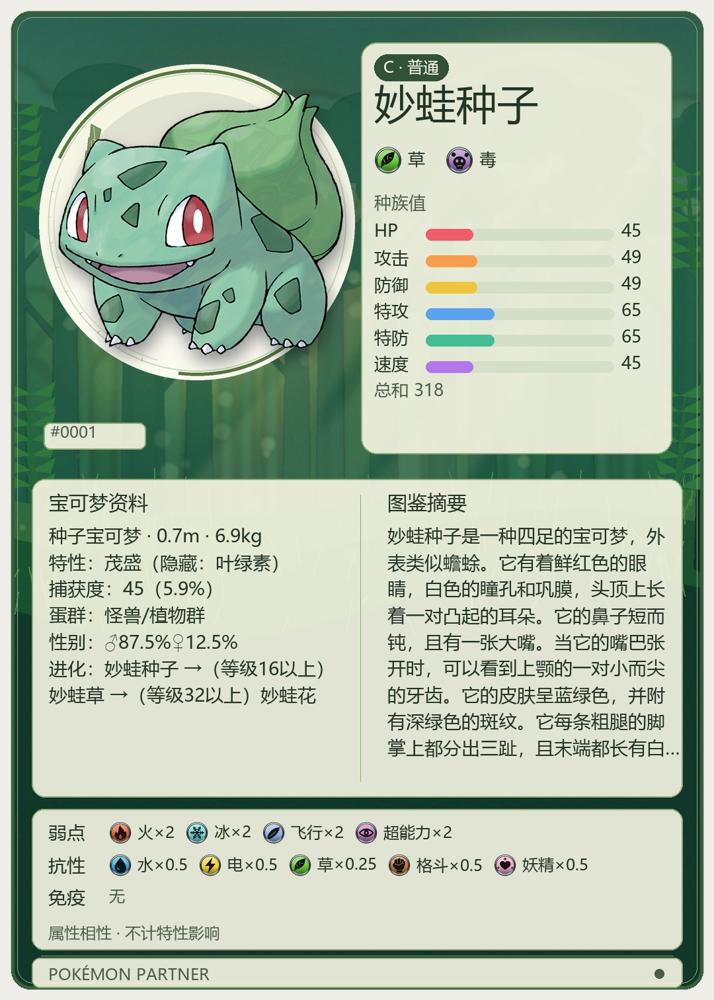
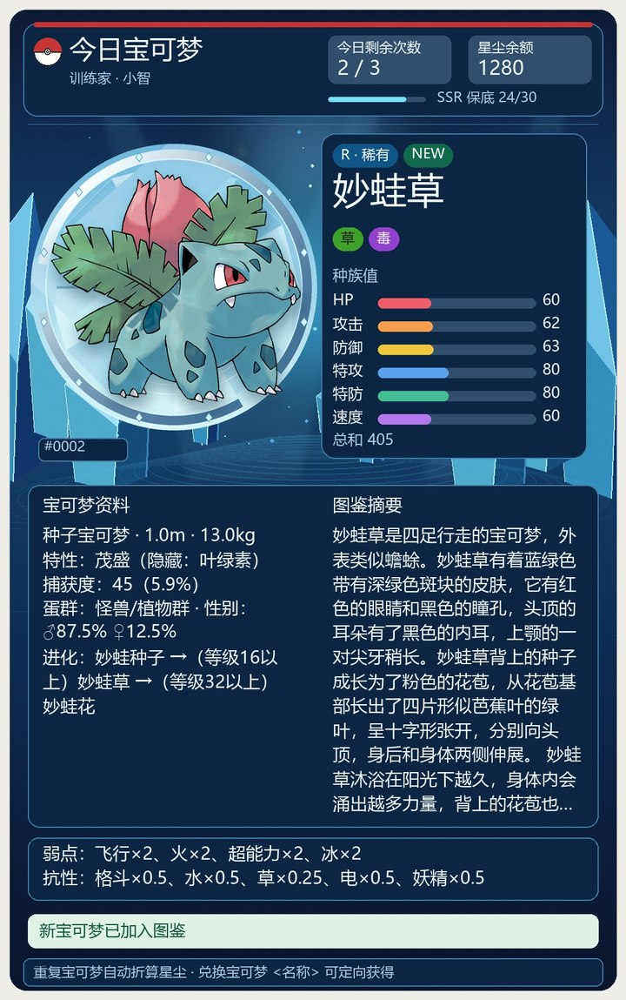
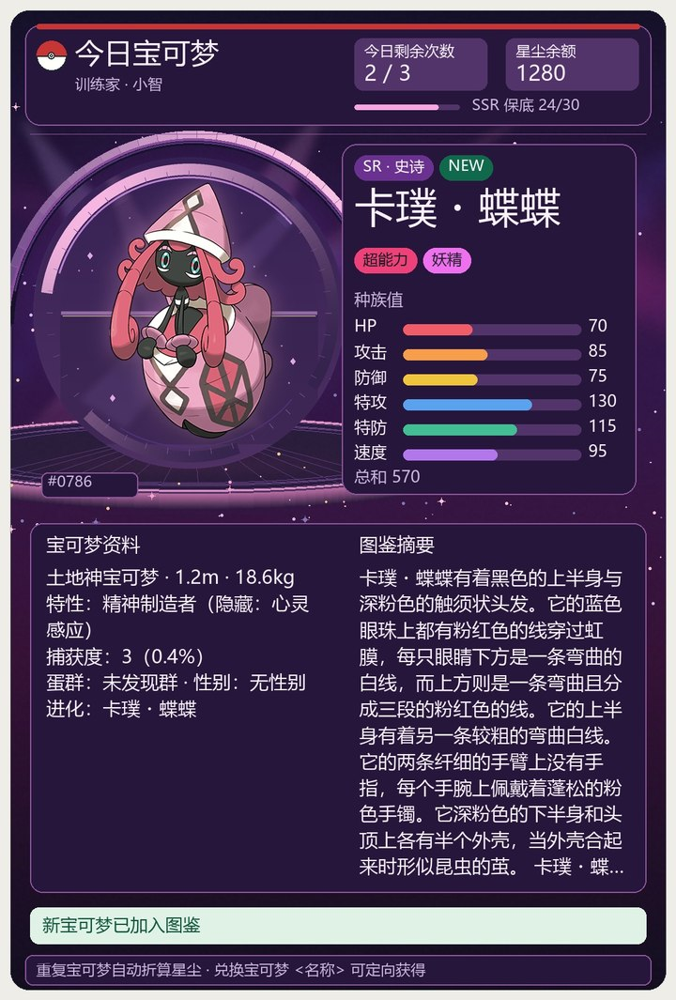
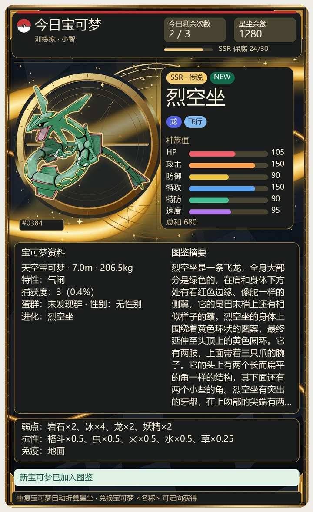
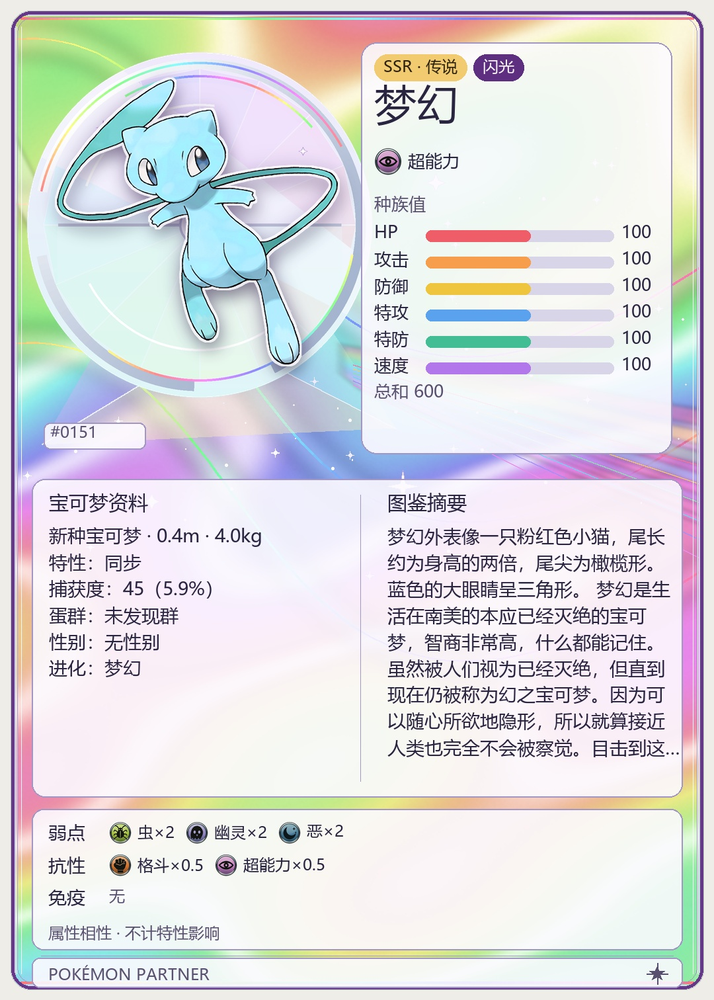
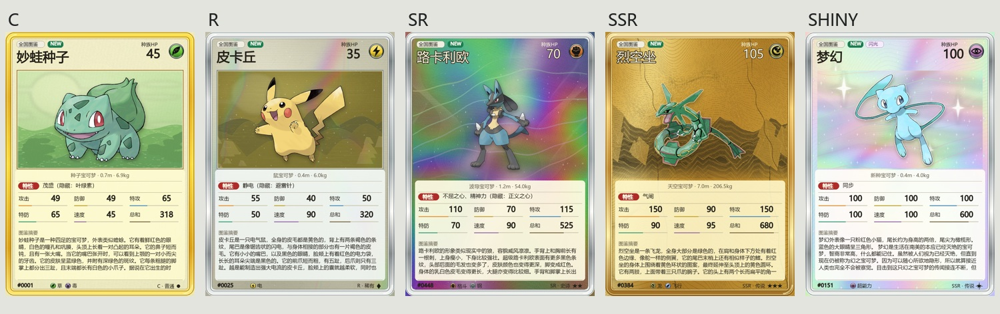

# 卡片预览

[返回首页](../README.md) · [玩法与指令](COMMANDS.md) · [安装与管理](ADMIN.md)

`今日宝可梦` 会根据稀有度显示不同的背景与材质。可在[卡面设置](CONFIGURATION.md)中选择现有卡面或 [TCG 收藏卡面](#tcg-收藏卡面)。下面是插件实际生成的卡面，点击图片可放大查看。

[查看五种卡面对照图](images/cards/preview.jpg)

## C · 普通

妙蛙种子，森林背景与象牙纸材圆盘。

## R · 稀有

妙蛙草，冰蓝晶簇与折射透镜圆盘。

## SR · 史诗

卡璞·蝶蝶，紫晶金属圆盘与舞台聚光。

## SSR · 传说

烈空坐，黑曜金质浮雕、金箔反射与星图。

## 闪光

闪光梦幻，珍珠全息圆盘与光谱折射，优先显示真实异色立绘。

闪光宝可梦也有自身的稀有度，闪光外观会优先显示。多抽时使用对应主题的网格卡面。

## TCG 收藏卡面

保留实体卡比例、金属边框、姓名与 HP 标题栏、属性能量图标、插画区和稀有度标记。卡内的 HP 与能力值均为本插件的种族值，抽取和对战规则照常使用。

| 卡面 | 材质与大图 |
| --- | --- |
| C · 普通 | [黄边纸卡与绘本画窗](images/tcg/common.jpg) |
| R · 稀有 | [银边反闪与属性暗纹](images/tcg/rare.jpg) |
| SR · 史诗 | [全图彩箔与浮雕走线](images/tcg/epic.jpg) |
| SSR · 传说 | [金箔、蚀刻与金属颗粒](images/tcg/legendary.jpg) |
| 闪光 | [珍珠银、虹彩星面与真实异色立绘](images/tcg/shiny.jpg) |

单抽附带宝可梦资料；多抽把每张实体卡排成两列，逐张显示新获得或重复转化的结果。

视觉参考取自公开的 Pokémon TCG 实卡图：经典[皮卡丘](https://api.tcgdex.net/v2/en/cards/base1-58)、现代[红莲铠骑](https://api.tcgdex.net/v2/en/cards/sv01-041)、[喷火龙 ex 全图](https://api.tcgdex.net/v2/en/cards/sv03-215)、[金色高稀有卡](https://api.tcgdex.net/v2/en/cards/sv03-228)与[异色皮卡丘](https://api.tcgdex.net/v2/en/cards/sv04.5-131)。卡面边框、图标、场景和印刷材质由插件本地绘制，参考实卡扫描没有加入插件。

宝可梦形象与名称的版权归任天堂 / Game Freak / The Pokémon Company 所有。
